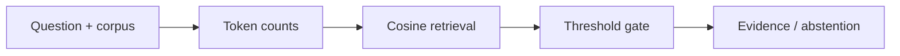

# SafeRAG

**Evidence-grounded extractive retrieval with abstention**

 

## Overview

Evidence-grounded extractive retrieval with abstention. This compact, dependency-free Python baseline is intended for reproducible experimentation and extension.

## Architecture



## Quick start

```bash
git clone https://github.com/rohanst14/SafeRAG.git
cd SafeRAG
python -m pip install -e .
python examples/demo.py
python -m unittest discover -s tests -v
```

## Example

```python
from saferag import *
result = answer('reactor pressure',{'manual':'reactor pressure rises','other':'ocean waves'})
print(result)
```

## Repository guide

| Path | Purpose |
|---|---|
| [src/saferag](src/saferag) | Core implementation |
| [examples/demo.py](examples/demo.py) | Runnable synthetic demonstration |
| [tests/test_core.py](tests/test_core.py) | Regression tests |
| [docs/methodology.md](docs/methodology.md) | Method and limitations |

## Limitations

Lexical retrieval baseline; no generative model or semantic embedding. Similarity is not calibrated confidence.

This is an AI-assisted portfolio prototype, not a production system or published scientific result.
